# Changelog

## 0.3.24

## Honor, grass and dead gnomes

### New

Honor
- The Honor view is rebuilt with a side rail: your Honor Points balance with how much room is left to the cap (it turns gold at 90%), your tiles, and your goals on the left; the charts on the right.
- The chart over time now follows your real Honor Points balance, so buying something shows as a red drop. Battleground honor is orange, world PvP honor blue, and the cap is drawn as a line once you get near it.
- Goals: add up to five items with their honor cost. Each shows how close your balance is, how much is left and about how many days it takes at your pace, plus a total for all of them. Goals use your real balance, so the Restart button is gone. An existing goal is kept. Long goal names are shortened without breaking a letter.

Casting bars
- Two new textures for casting bars only: Long grass, three layers of blades drifting past at different speeds with a gentle sway (a fourth on High quality), and Dead gnomes, little gnomes lying at random angles in three drifting layers.
- Each casting bar can now pick its own texture (Player, Target and Focus, under each bar's settings). Same as all bars keeps following the shared Bar texture.
- New Rounded corners option (Square, Small, Medium, Large): the bar, its fill, background, border and animated texture all get round corners. A bar too thin for the chosen size gets a smaller one.

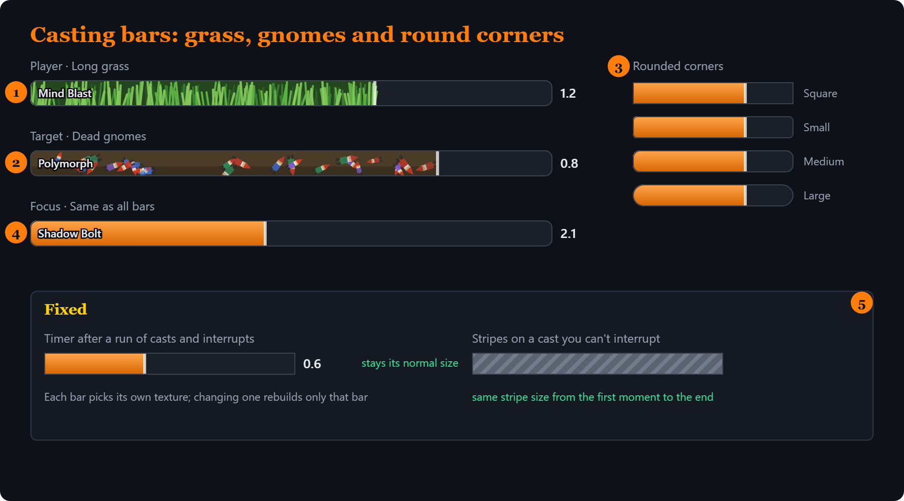

1. Long grass on the player bar
2. Dead gnomes on the target bar
3. Rounded corners, from Square to Large
4. Each bar picks its own texture, or follows the shared one
5. The timer and stripe fixes

Voice Alert presets
- The presets are rebuilt as a row of pills, each with an icon and how many alerts it turns on. Pick one to see underneath what it does and what would change (how many alerts turn on and off), then press Apply. The preset that matches your switches exactly is lit green and marked ACTIVE, and it is the one selected when you open the page again, also after a reload.
- Three new presets: Defensives only (enemy defensives, so you know when to hold your burst), World PvP / stealth (stealth, trinkets, crowd control on you and big cooldowns) and Quiet (only crowd control on you, interrupts on you and trinkets).
- Save your own: type a name and press Save current to keep your switches as a preset, up to five. Pick a saved one and press Delete, then Confirm, to remove it.
- Undo now goes back up to five steps, and names the step it undoes.

New class voice alerts
- Eight new enemy buff alerts, each in its class list on the Voice Alerts page: Ghostly Strike (Rogue, on), and off until you switch them on: Bestial Wrath (Hunter), Ice Barrier (Mage), Power Word: Shield (Priest), Amplify Curse, Fel Domination and Soul Link (Warlock), and Holy Shield (Paladin). Every rank of each spell counts.
- Bestial Wrath sits on the hunter's pet, so it alerts when an enemy pet you have targeted or focused goes berserk. No other pet buff alerts.
- Power Word: Shield is cast often, so after one alert the same priest stays quiet for 15 seconds; other priests still alert.
- Arcane Wrath (Mage) joins the cast alerts, every rank. Like the other enemy cast alerts it plays only when the game shows which spell is being cast.

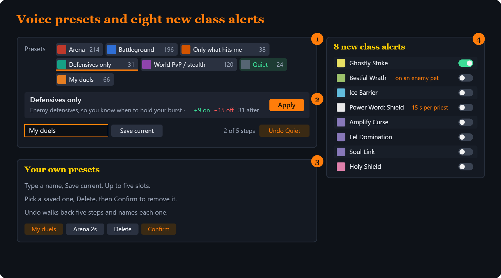

1. Preset pills with how many alerts each turns on; the active one is lit green
2. Preview what changes, then Apply
3. Save, delete and undo your own presets
4. The eight new class alerts

Proximity toasts
- Two new toast styles: Narrow stripe, a thin band with the enemy's icon, name and one line (class, distance, level, group) that glows at both ends in the class colour; and Stripe, slides in, the same band gliding in from the left and out to the right. Pick them under Toast style. A style change made in combat applies when combat ends, and toasts on screen are cleared when the style changes. Clicks, Ctrl-click to watch and the WATCHED tag work the same.
- New "Speak with toasts" option: turn it off and the toasts still show, without the class name and "detected". The Play button next to Show toast notifications now speaks the sample too while it is on, and Speak with toasts has its own Play. Both previews speak even during quiet times such as a flight path.

Stealth alerts
- New "Stealth from any enemy in range" option (Proximity Alerts, Stealth, on by default): Stealth, Prowl, Vanish and Shadowmeld still alert for every enemy nameplate near you, while other spell alerts follow Target & focus.

Diminishing Returns
- New row for yourself: crowd control on you is counted like on your target and focus, on its own row you can move.
- The options are rebuilt as one card per row (You, Target, Focus), like the chat alert cards: open a card to choose its own categories, whether it says "immune" (off for you by default), or copy its categories to the other rows. Your current categories and voice setting carry over to every row.

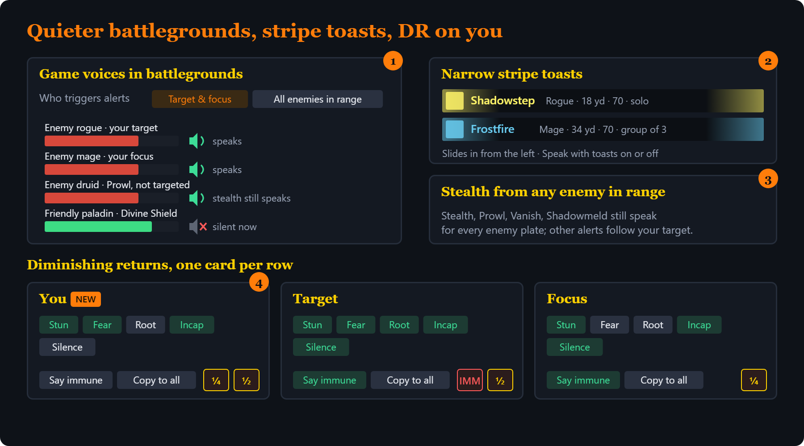

1. Game voices follow your target and focus, so friends stay silent
2. Narrow stripe toasts
3. Stealth alerts from any enemy in range
4. Diminishing returns on yourself, one card per row

### Improved

Battleground view
- The match list is easier to read: rows are taller with a clearer line between them, and each match has a green or red edge for a win or a loss next to its W or L. The column names are short (KB, HK, DTH, DMG, HEAL, HONOR) so they are no longer cut off; hover one to see the full name. The team lists and your damage by spell inside an opened match get the same spacing and dividers.

Spell Tracker and options
- The Add a spell section of the options now stands out from the list of tracked spells: a warm card with an orange edge and a soft glow, headed "+ ADD A SPELL".
- Text boxes in the options (the spell ID box, names, notes) now have their own dark inset with an outline that turns orange while you type, so they no longer blend into the row when you hover it. Rows inside the Add a spell card hover with a warm tint instead of grey. The Voice Alerts checkboxes get the same dark inset and outline, so an unticked box stays visible when you hover its row.

Update notice
- The update notice now reads like the login line: "SoundAlerter has a newer release. Update it through CurseForge." The name shows once, in its own colour, without the extra "SoundAlerter:" prefix in front.

Less work
- Proximity alerts do less work where they are off: in a sanctuary, a zone you turned off, the first seconds after loading or while snoozed, an enemy is skipped before the addon looks at it, and the once-a-second recheck only runs when you limit the alert band. Party sightings now follow the same checks as your own, in the same order.
- The view only redraws when your honor changes, instead of checking every second while it is open.
- Changing one bar's texture rebuilds only that bar.
- Toasts no longer rebuild their backdrop each time one appears; each toast frame is styled once.

### Fixed

Voice Alerts in battlegrounds
- In battlegrounds the game's own buff voices also played for friendly players, because they listened to every nameplate around you. They now listen only to your target and focus, as the Who triggers alerts setting says. With All enemies in range they listen to the nameplates too.
- When the game hides whether a player is friendly or hostile, the addon treated them as an enemy, so a friend's buffs could play an alert. A hidden answer now counts as not hostile, and your target's and focus's side is worked out once when they change instead of on every buff.

Casting bars and Spell Tracker
- The timer next to a casting bar could grow huge and stay that way after a run of casts and interrupts, so every later cast showed an oversized number off the edge of the bar. The low-time pulse on the timer now always returns to normal size when a cast ends, is interrupted or a new one starts. The same fix applies to the timer on Spell Tracker icons.
- On a cast you can't interrupt, the grey bar's diagonal stripes no longer start squeezed together and spread out as the cast fills. The stripes keep the same size from the first moment to the end, in every fill direction.

Honor
- The kills and bonus split per match is fixed. On this server kill honor and bonus honor read the same in chat, so bonus honor was counted as kills. A line now counts as kill honor only when your honorable kill count goes up with it. Matches saved before the fix show as one plain bar.

Names in other alphabets
- Player names written in Cyrillic, Korean or Chinese could show as boxes on the proximity toasts, the battleground card, Statistics and the options pages, because the addon drew that text with a font that only has Latin letters. That text now uses a font with the game's own fallback for each alphabet, so those names show as written.

## 0.3.23

## Damn you BG bugs

Speed Meter
- The meter shows your real speed while you move: walking reads about 36%, backpedalling and slows show as they happen, and a flight path shows its own speed. Standing still it shows the speed you would move at, as before.
- In combat the game hides your speed, which left the meter blank. It now measures how fast you actually move, and while you stand still it keeps the last number it had, dimmed and marked with a ~ (for example ~132%).
- New "Tint mounted speed" option on the Speed Meter page (advanced) colours the number while mounted or flying too.
- The meter only works while you move or something changes your speed, so standing still costs nothing.

Battleground results
- After each battleground a small pill appears under the minimap button for 2 minutes (once you are out of combat), showing the result, the map and your best stat. Click it for your card: victory or defeat, length, honor, and your killing blows, honorable kills, deaths, damage, healing and objectives (flag captures and returns, bases) with your rank among all players, gold where you were best, plus badges such as "Most flag captures" and "Never died". The game only reveals the scoreboard numbers when the match ends, so the card appears then. Turn the pill off on the Statistics page.
- Statistics has a new BG view next to All-time and Session: your totals (matches, win rate, honorable kills, killing blows and deaths per match), a filter per battleground, and your last 50 matches. Open one to see its card, both teams side by side with a bar per player and a tab per stat, and your damage by spell for that match. Both teams are kept for your 10 newest matches.
- The Matches list is gone from the All-time and Session views of Statistics; your battlegrounds are in the BG view.
- Statistics has a new Honor view: today, this week, honor per match and per battleground hour, and your best match, then a chart of your running honor over 7 days, 30 days or since tracking began (a dot per battleground, world PvP honor in blue, your daily pace as a dashed line), and a bar per battleground for your last 30, split into honor from kills and bonus honor, filterable by map. Type an honor goal, an item's cost for example, to see your progress and about how many days it takes at your pace. World PvP honor counts from the honor chat lines; battleground honor comes from the scoreboard, so matches you already played show up too.

Battle voices (fixed again)
- Battle voices (the game's own voices for enemy buffs in battlegrounds and arenas) could stay silent for a whole match: the addon held back while any game lock for addons was on, and the game locks addons for the length of a PvP match. It now holds back only in combat, registers the voices the moment the game announces the match lock (the game still allows it then), and if the game ever refuses, it tries again once the lock lifts instead of every 2 seconds. A refusal costs one call, not one per spell and unit.
- `/sa probe` shows the battle voice state (ready, waiting for combat to end, or refused), when they were last registered and the match state at that moment, plus which game locks are on now. `/sa aurasound` shows the locks and the match state too.

Settings
- Selected choice chips, such as the channels under Sends to and the Preview as choice in Chat Alerts, no longer show as plain green blocks with no text until you click them.

Spell Tracker
- Tracked target debuffs such as Rip and Lacerate no longer vanish when you switch targets. Each enemy keeps its own timers: target another enemy and they hide, target the first one again and they come back with the time they really have left. A dead enemy's timers are not brought back. In dungeons the game hides which enemy is which, so there they still clear on a switch.
- Trackers now follow every rank of a spell: tracking Rake starts its timer from whichever Rake rank you cast, out of combat any rank on the target is read and its length learned, and learning a new rank no longer silences a tracker. Casting Pounce also starts a tracked Pounce Bleed (with its own length), and any spell starts a tracked bleed of the same name.
- Target auras are read at most once per frame instead of on every aura change, which saves work in busy fights.

## 0.3.22

## Battlegrounds find their voice

Casting bars
- Mouse over the target or focus casting bar during a cast to see the full spell tooltip: name, rank, cost, cast time and description. It works for enemy spells the game hides too, because the game draws the tooltip itself.
- The bar only catches the mouse while a cast is up, so clicks and camera drags pass through the rest of the time. Turn it off with "Spell tooltip on hover" on the Casting Bars page.

Voice alerts
- Every voice alert now starts about 0.15 seconds sooner: the silence before each recording was trimmed. The voices and their endings are unchanged, cut without re-encoding.
- Switching a spell on or off on the Voice Alerts page now reaches the game-played voices at once. Before, "Let the game play debuff alerts" only picked up the change on the next target or zone change.
- The Spell Alerts tab is rebuilt spells first: the class list and the spells are right at the top instead of below two screens of settings. Each spell is one row with its events as switches you click directly, a play button on hover and a box that switches them all; the expand badge is gone, and search no longer stops at 40 results. Arena extras, interrupts, loss of control and the game voice switches moved into "More options" drawers at the bottom, closed until you open them.
- A "Where and who" strip at the top sets the zones spell alerts play in (World PvP, Battlegrounds, Arenas) and who triggers them (target and focus, or all enemies in range), the same settings as in Quick Start. "Preview as" (World, Battleground, Arena) marks every event: played by SoundAlerter, played by the game, hidden by the game there, or not tested yet. In a battleground only "Enemy gains it" can play, through the game; arenas are still marked as not tested.
- Events have plain names: Enemy gains it, It ends, Starts casting, Uses it, Lands on you, Lands on a friend, Lands on an enemy, Your CC ends, Interrupts you. "Silence whole categories" is replaced by an on/off switch on each event chip above the list (on means it plays), and clicking the chip's name shows only the spells with that event. Event kinds that are off dim their switches on every spell. The "Silence all" preset is gone, since switching every event chip off does the same.

Global Sightings / Enemy Finder
- A single report now counts in full: no more "one report, not confirmed yet" note, and single reports are no longer dimmed on the map, the minimap or the zone card. "Hot" counts every recent sighting.
- The continent card shows only that continent: Kalimdor no longer lists Eastern Kingdoms zones, and its enemy, zone and watcher counts match. Azeroth still shows everything.
- New map and minimap markers: each enemy is a class crest in a dark disc, sharp at any zoom. A ring around it empties as the sighting ages, a small notch points where they were heading, an eye marks classes that can stealth, and enemies standing on the same spot share one crest with a count badge (the tooltip says how many more). Continent rings show the top three class crests around the count, with a red diamond when higher-level enemies are there.
- New installations see a small "Global sightings on" note under the minimap. Hover it for the details and Keep or Turn off; closing it keeps sharing on. Nothing is sent until you choose, and logging out without choosing keeps it on. Existing installs are not asked again.
- New Enemy Finder in Developer Tools: search every enemy spotted in the last 10 minutes by name (typos are fine), class, race or zone, and see where they are, where they came from, when they were seen, how many players reported them and how far away. It refreshes every 5 seconds while open. Click the Name, Zone, Level or Seen header to sort; click again to reverse, a third time to go back to best match.

Chat alerts
- Proximity chat lines say more: "Druid Leafy (60 Night Elf) near Stables 45,61", with the level, race, subzone and your map position. Enemies seen within 1.5 seconds of each other are sent as one line, for example "3 enemies near Stables 45,61: Druid, Rogue, Mage". Your own template can use the new #level#, #race# and #place# tags.
- Chat alerts are limited to about one line every 1.5 seconds (three at once), so a busy fight cannot flood your group or get you muted. Voices and toasts are never held back. /sa stats shows lines sent, merged, held back and blocked by the game.
- The "Chat alerts" item in the minimap menu and key binding showed the opposite of its real state. It is now ticked when chat alerts are on.
- The Chat Alerts tab of Voice Alerts is rebuilt around one card per area: spell alerts, proximity, battlegrounds and custom alerts. Each card shows whether it is on, where its lines go and a sample of the line, and opens to its channels, what it announces and its texts. One "Send chat alerts" switch at the top turns everything on or off. Each area picks its own channels (Say, Party, Raid, Battleground) and "Use for all areas" copies them to the others; the old default channel set and its "None" choice are gone, and your current channels are carried over to every area. The Proximity and Battleground pages keep their chat switch, and their "Open chat settings" opens their own card.
- "Preview as" (solo, party, battleground, arena) shows where each line really goes. It starts at where you are now. Channels that cannot work there are dimmed and explained: Say only works inside instances, Party needs a group, Raid a raid, Battleground a battleground or arena group, and in a battleground or arena the Battleground channel already reaches your party and raid, so they are not sent twice. When no channel is left the line is printed only in your own chat window, and the card says so. "Print sample lines in my chat" shows one sample per area.
- Spell announcements are grouped by situation, each group with its own switch and count: CC on you or a friend, your team's CC on an enemy, stealth, enemy cooldowns and interrupts. Each group holds its switches and the texts it uses. Every chat line can be edited, now including Divine Shield, "X down on Y", proximity and each battleground event, with clickable tags and a Default button, and the sample updates as you type. The "CC landed" text is shared by CC on an enemy and stealth, and both places say so.
- Silencing a sound category no longer silences its chat lines (interrupts, enemy buffs and cooldowns, cast start). Chat has its own switches and the "Send chat alerts" switch.
- Chat switch fixes: Fear on an enemy is announced for every rank, not just one. Sap on you or a friend has its own switch. "Polymorph" is split into "Polymorph on enemy" (now announced when it lands) and "Polymorph on you or a friend". The "Target and focus only" switch, which never did anything, is removed. The Notices switch is renamed "Print in my chat window", since nobody else sees it.

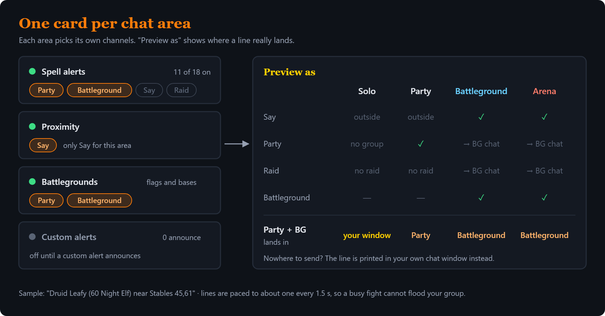

Watchlist
- Watched players now get a red WATCHED tag and border on their proximity toast, and one voice instead of the watchlist voice followed by the class voice.
- Ctrl-click a proximity toast to watch that player, or Ctrl-click again to stop. It works in combat and does not change your target.
- Global sightings check your watchlist: a watched player reported in your zone gets the watchlist voice and a toast that says who spotted them. Enemy Finder shows watched enemies on a red row wherever they are, and Ctrl-click on a row watches or unwatches.

Battlegrounds
- Enemy buffs and cooldowns are voiced in battlegrounds and arenas. The game hides enemy spells there, so SoundAlerter could not hear them; now, when you enter, it hands the game every enemy buff and cooldown you have switched on (Divine Shield, Ice Block, Evasion, trinket and the rest) and the game plays your voice pack itself when an enemy on your target, your focus or one of the first 20 nameplates gains one. It is set up out of combat, before the gates open, and removed when you leave; a spell switched on or off during a fight takes effect after it. The game cannot tell friend from foe here, so an ally on your target or a friendly nameplate can trigger a voice too. These voices are not counted in Statistics, and the Visuals note says so. On by default; turn it off with "Let the game voice enemy buffs in BGs and arenas" under Voice Alerts, Engine and procs. Tested in a battleground, not yet in an arena.
- A teammate returning your flag no longer sounds like "Enemy... flag returned". The class voice now finds players by their full two-part name and from the battleground scoreboard, and when the class is still unknown, your own team's events skip the "enemy" voice.
- Proximity alerts and the watchlist now work in battlegrounds. The game hides enemy player IDs there, so these alerts were silent; enemies are now recognised by name instead. "Enemy targets you" still cannot work in battlegrounds, because the game also hides who an enemy is targeting. The class comes from the battleground scoreboard when the game hides it, an enemy whose class stays unknown is announced as "enemy", and a hidden level no longer stops the alert. These alerts are not shared with your group, since teammates in the same battleground see the enemy too.
- Arathi Basin base alerts: when a base is assaulted, taken or defended you hear the base name and then one word for what happened, said from your side: "Stables attacked", "Gold Mine lost", "Farm retaken" for the enemy, "Stables assaulted", "Gold Mine captured", "Farm defended" for your team. The toast reads the same ("STABLES ATTACKED", with the player below), and so does the default chat line. Each event has its own switch and preview on the Battleground Alerts page, and the team filter applies. Eleven new voices (the five base names and six outcome words) are included; the pause after the base name follows its length, from 0.65 s for Farm to a full second for Stables.
- Flag and base chat lines now go to the chat channels set on the Voice Alerts page (Party and Battleground by default) instead of Say, and they are no longer held back during combat. Each flag and base event has its own text: a return says "Grim returned the flag" instead of "Rogue has the flag!", and a lost base reads "Gold Mine lost". A flag text you changed before is kept as the pickup text.
- Battleground alert voices queue smarter: at most four wait their turn, anything older than five seconds is skipped, and a newer event for the same base replaces the older one.

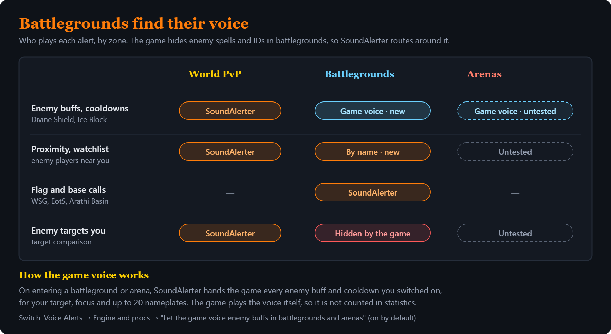

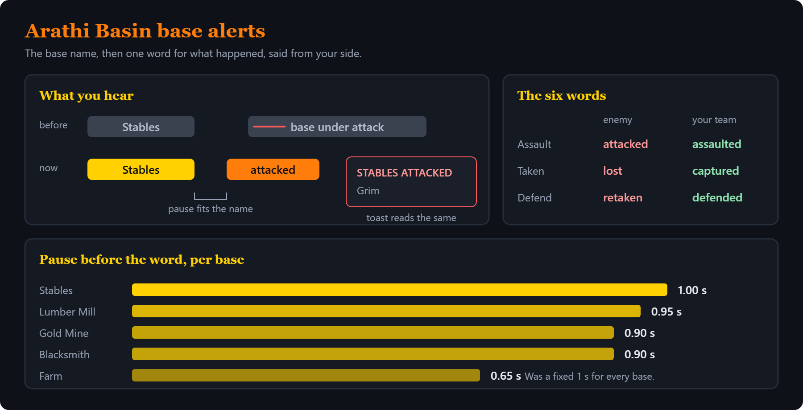

Statistics
- The spell diagram on the Visuals tab is honest about battlegrounds: its battleground circle is dimmed and labelled "hidden by the game", and hovering the label explains that the game hides enemy spells from addons there and does not report the voices it plays, so neither can be counted. The Global tab says the same under its battleground ranking.
- New Classes view on the Visuals tab: switch between Spells and Classes above the diagram. Each crest is a class in the class colour with the number of enemy players you met only in arenas, only in battlegrounds, only in world PvP or in several of them. It works in battlegrounds too, since proximity alerts recognise enemies there by name. Hover a crest for the players, click a class in the legend to hide it. Below, one bar per zone shows the class mix of every enemy player you met there, counted once per player and zone from now on; the crests come from your 100 most seen enemies, which is all the statistics keep by name. The Snapshot panel is a little taller to fit it.

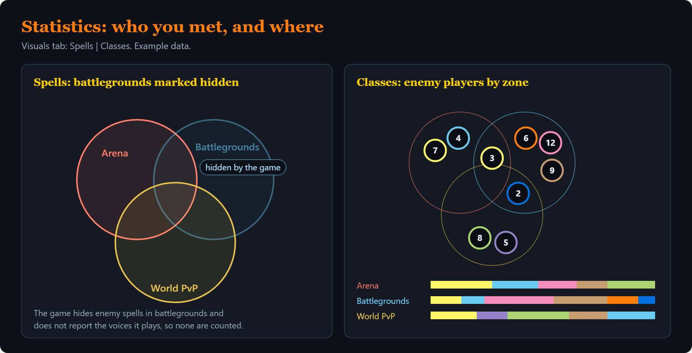

## 0.3.14

## Dungeon interruptions

Interrupts
- Interrupt alerts now work in dungeons, where the game hides the enemy's name and spell. The alert names your target or focus instead.
- Your party gets "Interrupted target with [Feral Charge]."; the hidden spell is left out because the game does not allow it in sent messages.
- Your own chat window also gets a line with the interrupted spell's icon and link: "Interrupted target's [Flamestrike] with [Feral Charge]." Solo, you get only this line. Shift-click the link to share it in chat yourself.
- One interrupt no longer alerts twice when the enemy is both your target and under your mouse.
- Enemy cast bars with hidden timing no longer stay on screen after an interrupt; the bar closes as soon as the cast is gone.

Chat alerts
- "From enemy to friend" and "Sap on a friend" work again: when a party member is Sapped, Blinded, Polymorphed, Hexed or Feared, your group gets the line. They follow the "on you or a friend" switches.
- "From enemy to you" names the caster instead of starting with a blank: "An enemy cast [Blind] on me!". Both lines say "An enemy" when the caster is unknown.
- Both Sap texts now sit under the Sap switch that actually sends them.
- Turning chat alerts off now also silences custom alert and proximity chat lines, which used to send anyway.
- A backslash typed into a chat message is now removed in every alert, not only the interrupt lines.
- Removed the "Enemy debuff down (from you)" switch, which never did anything.

Statistics
- The overview is now a dashboard: six tiles (alerts this session and all-time, per session or your match record, top enemy, top alert, top place) and four cards (alert mix, top spells, top enemies, where).
- One switch shows the session or all-time, and is remembered. Session spells, enemies and places are now counted too.
- Matches show the last 5, and the full spell, enemy and class lists open on demand with their sort choices.
- No Refresh button: the page redraws itself when the numbers change. "Danger" is now "Threat", a sort choice with an explanation, no longer printed on every row.

Global statistics
- Spells now show from a single player's reports, so the tab fills even when you are the only reporter.
- Reports no longer carry decoy spells, so every listed spell was really seen. Decoys added little privacy, since Global sightings already shares far more under your name, and they showed up as fake entries, including arenas Forever does not have. Copies older than 0.3.14 still send them for a while.
- The empty tab says how many players are reporting.

Voice Alerts
- New Shaman alerts: Windfury Totem, Elemental Mastery, Nature's Swiftness and Rage of the Farseer.
- Windfury Totem calls once when enemies gain its buff, then waits 30 seconds, so a whole group standing at one totem does not repeat it.
- New enemy alerts: Voice of Truth (Paladin, immune to silence and interrupts, hold your kick), Feedback (Priest, stop casting at them), Rapid Fire and Feign Death (Hunter).
- New "On you" alerts: Confounding Flash (Priest), Concussion Blow (Warrior) and Intimidation (Hunter pet).
- All are on by default and sit under their class on the Spell Alerts page.
- Enemy Cannibalize, Last Stand and Earth Shield, and Freezing Trap ranks 1 and 2 on you, now alert. They were listed under the spell that starts them instead of the buff or debuff they leave.

Diminishing Returns
- The categories now come from Forever's own diminishing returns table, so the tracker shows the stage the game really uses.
- Kidney Shot has its own diminishing returns (shared only with Between the Eyes): after a Hammer of Justice it shows as a full stun, no longer as half.
- Cheap Shot and Pounce share the normal stun, so a stun before them now counts. The separate Opener category is gone.
- Banish counts as Incapacitate. Wyvern Sting now uses Forever's spell, so it is tracked.
- New categories: Charm (Mind Control), Proc stun (Impact, Mace stun, Blackout, Improved Concussive Shot) and Proc root (Entrapment, Counterattack, Frostbite, Improved Hamstring, Improved Wing Clip).
- Many more crowd control spells are tracked, among them Sleep, Shackle Undead, Turn Evil, Hex, Chastise and Confounding Flash.
- New voice: "immune" when crowd control lands on your target or focus and the next one of that kind would do nothing. A switch on the Diminishing Returns page turns it off.

Cast Feed
- Hovering an enemy's cast now shows the full spell tooltip (rank, cost, cast time, description) even when the game hides the spell, instead of only its name.

Smoother frames
- Proximity toasts in combat slide with the game's own animation.
- The Trinket Menu waits for its fade without running any code.
- The combo point fill slides at the same speed at any frame rate.
- The Statistics page builds only the lists you open and redraws at most once a second, only when something changed.

Login line
- The login line no longer repeats the addon name and now shows the version: "SoundAlerter 0.3.14 by th3pajay · type /sa for options".
- After an update, the first login says what changed instead, and /sa whatsnew lists the highlights. A new install points to Quick Start.
- "Show the login line" under General turns the everyday line off; update news still shows.

Minimap
- SoundAlerter now appears in the game's AddOns menu by the minimap, with its own speaker icon (also shown in the AddOns list). Clicking it does what your minimap button clicks do, and hovering shows the same tooltip.

Under the hood
- Interrupt matching and every chat alert's text now run through two shared modules, so all alerts follow the same rules and are easier to fix.

Casting bars
- Enemy and friendly casting bars now show the time left, even when the game hides the cast's timing. The game itself counts it down, in your chosen time format, so no hidden value is ever read.

Fixes
- Retargeting a dead enemy you had combo points on no longer replays the full combo point celebration or its sound; the points just show. A living enemy you retarget still celebrates.
- The options window keeps its size and position when you close and reopen it, and after a reload.
- Opening /sa is faster: the options pages are built once instead of on every open.

How it works

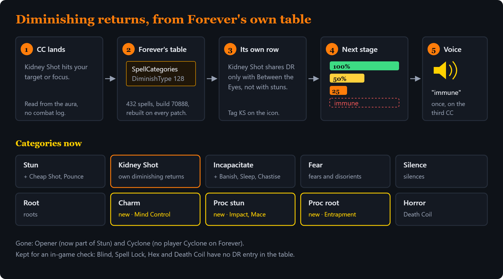

- The categories are generated from the game's own SpellCategories table for the current Forever build (432 spells on 70888) and rebuilt on every patch, so they match what the server applies.

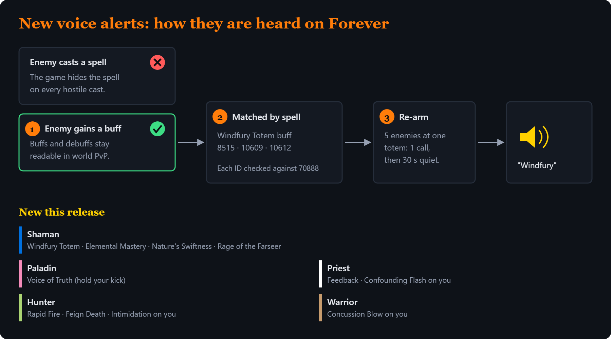

- Forever hides the spell on every enemy cast, so the new alerts listen for the buff or debuff the spell leaves, which stays readable in world PvP. Every spell ID was checked against the live game data.

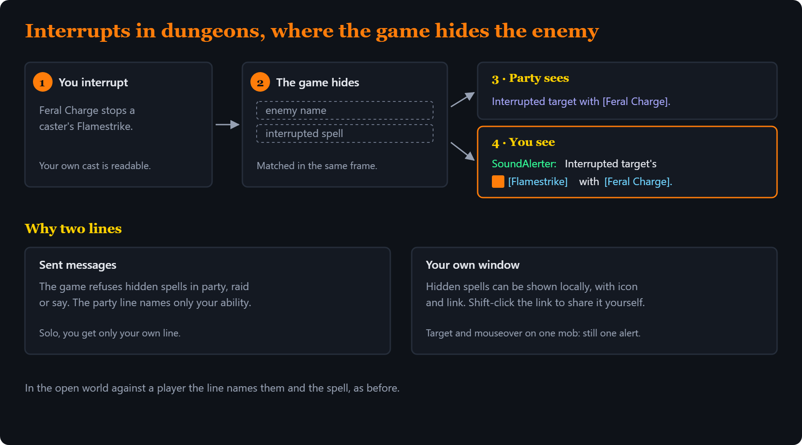

- Your interrupt and the enemy's hidden interruption arrive in the same frame, so they are matched without reading the enemy at all.

## 0.3.01

## Smooth rider

Global statistics
- New Global tab under Statistics: how many SoundAlerter players on your realm and faction saw each spell in arenas, battlegrounds and world PvP over the last 7 days. Scroll, sort by zone, filter by type, hover for details, click to open in Spell Finder.
- Export gives one short line (realm totals, no names). It is also kept in the saved file at logout for a companion program to publish. The addon itself sends nothing anywhere.
- Experimental, not live yet: a realm stats website for these exports is being built.
- Follows the Global sightings switch and its opt-out. Reports carry only spell and zone type, mixed with decoys; a spell shows once enough players saw it.

Global sightings
- Enemy markers on the world map are now their own setting, off by default ("Show enemies on the world map"). The zone and world panels stay on.
- Sightings, statistics, the update notice and party sharing now share one messaging system: one send limit per channel with sightings first, one list of blocked senders, and `/sa global mute` also covers update announcements.
- `/sa global` shows message counts per type.
- Long statistics reports now send in full.

Update notice
- Shows only after two different players have proven the same newer release, so one test copy can never announce an update, and it respects the channel's send limits.

Combo points
- Points ignite with a small spring when gained, drain when lost and spring in a wave at five, with rings on Normal and sparks on High, all on the game's own animation engine.
- New Fade out setting (Style's own, Sweep out or Collapse to centre) and an Empty colour.
- Combo settings are regrouped into Combo points and Combo animation; Lock position stays first.

Key bindings
- SoundAlerter has its own section in the game's Key Bindings list, with Trinket Menu, Windows, Alerts, and Layout and profiles headers. Nothing is bound by default.
- New: select the next or previous trinket set, open options, Spell Finder, Statistics or the setup wizard, snooze, switch proximity, battleground, chat alerts, notices or global sightings, play a test voice, lock bars and switch profile.
- Keys already set on the trinkets keep working and show on the Trinket Menu buttons. Lock bars and switch profile wait for combat to end; press again to cancel.
- The minimap button offers the same actions.

Fixes and polish
- Spell Tracker: Ready! no longer vanishes for a second after every ability in combat.
- Sliders: no orange flash while dragging, a ring shows the held handle, click the value to type an exact number, and the mouse wheel steps.
- The options page follows the window while you drag its edge.
- Energy bar out of Cat Form: shows a dimmed estimate of the energy a shift would give with Furor, instead of a full bar.
- Fixed a Lua error when changing the resource bar scale or lock with rage fade on.
- Removed the circling dot at High texture quality that looked like a second swing timer.
- Smoother Trinket Menu and toast fades.
- Sharper edges on every drawn shape, same look.

How it works

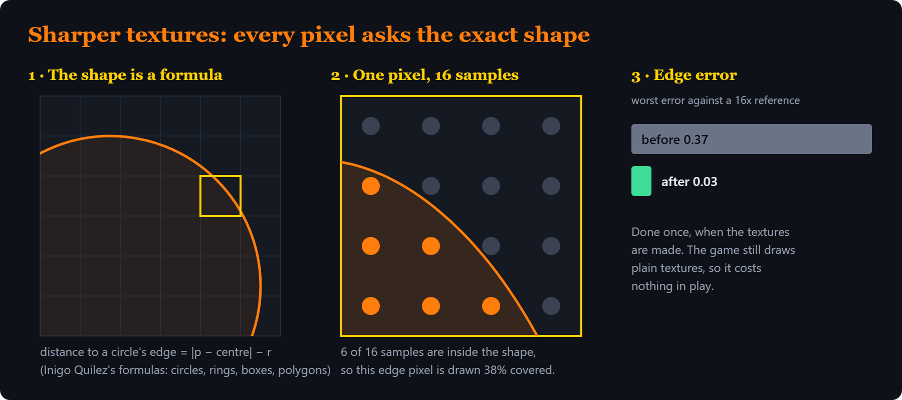

- Each shape is a formula giving the exact distance to its edge (Inigo Quilez's signed distance fields), sampled 16 times per pixel. Worst edge error fell from 0.37 to 0.03. Done when textures are made, so it costs nothing in play.

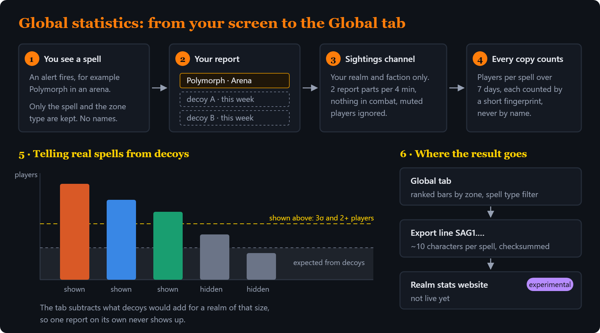

- Statistics count players, not alerts. Each report adds two weekly decoys picked with SHA-256 from a key that never leaves your computer; the tab subtracts the expected decoys and shows a spell only at three standard deviations above them and with two or more players.
- Players are stored as short SHA-256 fingerprints of their names, not the names.
- The export is a compact checksummed binary line, about 10 characters per spell.

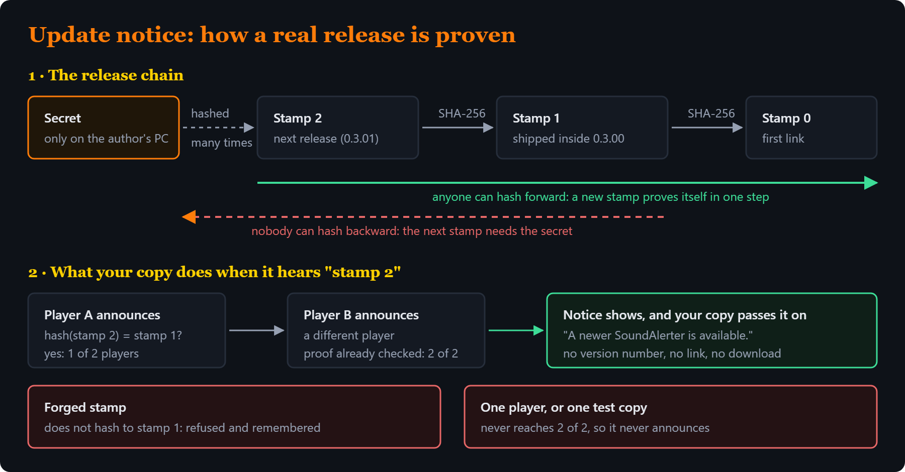

- Each release reveals one more link of a SHA-256 hash chain: anyone can check it by hashing once, nobody can make the next one. A copy needs that proof from two different players.

## 0.3.00

## Really?.. Venn diagrams?

Highlights
- Global sightings is out of experimental and on by default, with your opt-out under Proximity Alerts. Minimap dots are now a separate choice, off by default.
- The match debrief now shows whether you won or lost, plus your damage and healing, and Statistics has a new Visuals tab.
- New swing timer: a low-profile spark on your resource bar, off by default.
- Say when interrupt is ready learns your real cooldown, and interrupts now cover Forever's spells and every rank.
- Buffs you cast in combat stop their timer when consumed early, and toasts show the enemy's second name.
- New optional weapon swap button on the Trinket Menu that works in combat, and new Fire and Leaves bar textures.
- SoundAlerter can now tell you when a newer version is out.

Update notice
- SoundAlerter now prints one chat line when a newer version is out. Addons cannot reach the internet, so it learns this from other players' copies, and each announcement carries a proof that only a real release can have, so nobody can fake it. The notice never contains a link: update through CurseForge. It starts with this version, so older copies stay quiet. Turn it off under General, Updates; `/sa updates` shows what it knows.

Statistics
- New Visuals tab next to Now, Trends and Rivals: a Venn diagram of your spells by where they were seen. The three circles are Arena, Battlegrounds and World PvP; a spell sits in the region for every zone it has fired in, so the centre holds the spells you meet everywhere.
- Spells are drawn as round icons, bigger for more alerts, with a ring in the colour of the spell type (crowd control, defensive, interrupt, removal, other). The heaviest ones sit nearest the middle of their region; whatever does not fit collapses into a +N bubble you can hover to list.
- The circle labels show how many spells each zone holds. The legend under the diagram shows and hides a spell type.
- Hover an icon for its name, type, ID, total alerts, the split between the three zones and the class that casts it most; the zones it belongs to light up. Click it to look it up in Spell Finder.
- The icons fly in when the tab opens and slide when the filter changes. Both follow the menu animations setting.
- The match debrief now shows the damage and healing you did in each arena and battleground match, with your three biggest damage spells and their share. The numbers come from the game's damage meter and are read after each fight, because the game hides them in combat. Your own damage meter is never reset.
- New `/sa meter` command: shows what the game's damage meter reports for you, to check that match results will work.
- Busiest hours on the Trends tab now has hour labels under the bars.
- The match debrief now says whether you won, lost or drew each arena and battleground match, with your record for the kept matches at the top. Match length now comes from the game when it reports one. Solo Shuffle shows no result.
- New `/sa perf` command: shows how much frame time and memory SoundAlerter uses, from the game's own addon profiler.

Voice Alerts
- Say when interrupt is ready now learns your interrupt's real cooldown per character, so talents and Forever's own values are respected instead of a fixed table. A single odd timing, such as a cooldown reset, does not change it. The fixed value is used until something has been learned.
- Interrupts now cover Forever's spells and every rank: all Earth Shock and Shield Bash ranks, Spell Lock, Feral Charge, Skull Bash, Rebuke and Silence. They count for your own interrupt messages and the ready voice, and an enemy using one on you now plays Lockout.
- The Lockout setting now applies to every interrupt used on you. Before, it only applied to Counterspell and Kick rank 1, and the others always played.
- Enemy Shield Bash (all ranks) and the other Spell Lock rank now play their voice alert.
- The Spell Lock ready voice now waits 30 seconds, not 24, matching the game's data.
- New Say my procs setting under More options, off by default: says the spell when one of your own lights up. The voice comes from the spell's name, so a matching mp3 in your voice folder just works, and `/sa procs` lists which of your procs have a voice.
- New alert for an enemy gaining Reckless Swings. It is off by default because it can fire every 15 seconds; turn it on under Warrior.

Spell tracker
- A buff you cast in combat now stops its timer when it is consumed or removed early, such as Nature's Grasp, and the icon goes back to idle. This works where the game shows aura changes; where it hides them, such as in a duel, the timer still runs its full length.

Resource bars
- New swing timer, off by default: Swing spark under Resource Management. A small spark runs along the top border of the bar your form uses and reaches the end as your next swing lands, with a brief flash you can turn off. Off-hand runs along the bottom border. It shows only while you are swinging and needs a resource bar shown. It covers melee and ranged, and runs on the game's animation engine so it costs almost no script time.
- The rage bar now empties when a druid leaves Bear Form instead of showing leftover rage that slowly drains, and starts from the real value when you shift back. The bar does no work while it is out of form.
- New Fade rage bar when empty setting: the rage bar fades out of view when you have no rage or are out of Bear Form, in Bear and Dire Bear Form as well, while the bars are locked.

Bar textures
- Two new animated bar textures for the resource bars and casting bars: Fire (three layers of flames that rise and flicker while drifting sideways, with a heat glow at High) and Leaves (autumn leaves blown sideways at three depths, with gusts, and larger leaves at High). Both cost about as much as Streaks.

Global sightings
- No longer experimental: Global sightings is now on by default, also in Quick Start. It shares the enemies you see and your rough map square with other SoundAlerter users of your faction on your realm, and shows theirs on your world map. To opt out, turn it off under Proximity Alerts, Global sightings. If you already use SoundAlerter, one chat message tells you this at your next login.
- Minimap dots are now a separate choice and off by default, so if you had them, turn on Show on the minimap to get them back. The world map overlay and panels stay on.
- Its settings now have their own Global sightings section on the Proximity Alerts page, apart from Party sharing. They are separate features with separate switches.
- It now waits 15 seconds after login or a loading screen before joining its channel, so your General and Trade channel numbers are left alone. If every channel is refused it retries every 5 minutes instead of every 10 seconds.
- On a busy channel, watcher counts can no longer crowd out enemy sightings.
- The world map card has a new look: a coloured verdict pill, three tiles (enemies with a trend, nearest, watching), a class bar with the three biggest classes, and compact rows with a level chip.
- Zoomed out to a continent or the world, the card now stays and shows the world: enemies with a trend, zones reporting, watchers, the class mix and the busiest zones. Hover a zone row to enlarge its ring on the map.
- Fixed the card jumping open and shut when the pointer sat on the lower part of the slim strip.
- The strip opens when you hover it, keeps its place for a moment after you leave, and stays open when you click its title. Opening and closing ease over 0.12 seconds with the menu animations setting.
- Zone panel and World panel settings under Global sightings: Strip, Always open or Off.
- Hover the Enemies tile to see how many enemies can stealth and how many are higher level than you.
- The card shows all rows by default; click the +N more or show less row to switch.
- Ages read now, <1m, 2m. The card no longer polls the pointer and only rewrites text that changed.

Proximity toasts
- Toasts now show the enemy's second name after the first, smaller and behind a thin divider. When both do not fit, the second name is cut first and hidden if too little room is left. Alerts shared by party members still show one name.
- Long names no longer run under the enemy's latest spell on the Intel card, and the Threat card gives the name row more room.
- On the Threat card, the enemy's latest spell moved down beside the aura icons, so a long threat reason no longer runs under it. A title too long for its line now ends in dots instead of wrapping into the row below.
- Showing a toast does less work: the buff and debuff scan stops once it has 3 icons.

Trinket Menu
- New optional weapon button, off by default, for swapping between damage and healing weapons mid-fight. Unlike the other swaps it works at once, also in combat. It changes the main hand and the off-hand, and has its own keybind under Key Bindings > AddOns > SoundAlerter.
- To set it up, turn on Weapon swap button in the new Weapons group. Wear your DPS weapons and shift-click the button, then wear your healing weapons and shift-click it again. The options page has Save buttons for each pair too. Pairs can only change out of combat.
- The button shows your worn weapon, a coloured border and label (amber DPS, green HEAL) and a corner badge with what a click equips. A red mark warns when the next weapon is not in your bags. Hover it out of combat to equip weapons from your bags, right-click to use the main-hand effect.

## 0.2.94

## Looks and glances

Trinket menu
- Ready glow: when a trinket comes off a cooldown longer than 30 seconds, a soft spark runs twice round its border. The 30 second lock after equipping a trinket never triggers it, and it stays off while the bar is faded or collapsed. On by default, switch under Look. The animation runs in the game client, with no addon code running per frame.
- Icons sit behind a thin black inset and dim while their trinket is on cooldown.
- Cooldown numbers turn gold under 10 seconds and red under 3.
- A dark backplate sits behind the bar.
- Button edges brighten on hover.
- The set button shows a split line between its two trinkets, and the set and gear labels sit on a dark pill. Keybind text is a softer grey.
- An empty trinket slot gets a grey edge and a dimmed icon.
- The bag flyout points at the trinket it belongs to.
- Collapsed to a diamond: opening the bar unfolds the buttons out of the diamond one after another, and the diamond spins back in when the bar closes. Both take 0.15 seconds and also work in combat.
- When a trinket comes ready while the bar is collapsed, one soft ring ripples out of the diamond instead.

Spell tracker
- Target nameplate: spells tracked on your target can sit in a row above its nameplate, with the same countdown, sweep, borders and effects as on screen. The one ending soonest is drawn larger in front. When the game shows its own aura icons on the plate, the row sits on top of them instead of over them. Off by default; turn it on under Target nameplate, and choose per spell under Selected spell (target spells go to the plate by default, your own spells always stay on screen).
- Options: icon size, spacing, distance from the plate, follow the plate's scale, show idle icons, most icons at once, and what to do when there is no plate (use the screen spot or hide).
- Works in combat. Only the addon's own icons are moved; the nameplate itself is never changed, and icons on a plate cannot be dragged.
- The nameplate settings travel in the Display block of a tracker export, and each spell's choice travels with the spell.

Diminishing returns (new, experimental)
- One row of icons for the target and one for the focus, one icon per crowd control category: stun, opener stun, incapacitate, fear and disorient, silence, root, horror, cyclone and banish. Each category can be switched off.
- Each icon shows the last spell that landed, with the category letters in the corner. The border shows how long the next one in that category lasts: green half, yellow a quarter, red immune.
- While the crowd control is up the icon counts it down; when it ends the icon dims and counts down the 18 second reset, then goes away.
- Crowd control from anyone counts, but only what lands on your target or focus can be seen. Effects in a duel are hidden by the game and skipped.
- Each row can be dragged anywhere: untick Lock position, drag, lock again. There is a button to put both rows back.
- Options: track target, track focus, icon size, spacing, countdown numbers, category tag, lock position, and a test button.
- Off by default; turn it on under Displays, Diminishing Returns. Only the addon's own icons are drawn.

Fixes
- Options: every page that has a lock now calls it "Lock position" and puts it first in General, with "Reset position" right under it. Casting Bars, Resource Bars and Spell Tracker used "Lock bars" or "Lock icons", and Resource Bars and Spell Tracker had no reset. New profiles start locked on those three pages too; your saved choice is kept. Casting Bars keeps "Apply pyramid layout" as its reset.
- Diminishing Returns: fixed a Lua error on some units. When the game hides what changed on a unit's auras, the tracker now re-reads that unit's auras instead of reading the hidden fields.
- Speed: when the game hides what changed on a unit's auras, the alert engine and the Diminishing Returns tracker now re-read that unit once per frame instead of once per event. Bursts of aura changes cost one pass. The speed meter also stops rebuilding its text when the number has not changed.
- Find Spell: inserting a spell into chat now finds the chat box you opened with Enter. Before, it could miss it and print the text in your own chat instead.
- Spell tracker: locking the icons now hides idle icons that have "Show when inactive" turned off. Before, they stayed faded on screen until another setting was changed.
- Spell tracker: the live preview lines no longer overlap when a line is long.

## 0.2.93

Voice alerts
- Templar's Bulwark: protection paladins can now have it purged or dispelled, so you hear it when an enemy gains it.
- Death Mark: you hear it when a subtlety rogue marks you, so you can decurse it or use a defensive before the stored damage lands 6 seconds later.
- Chain Lightning: a new cast alert now that it is a 2.5 second cast. Every rank is covered.
- Wild Growth now has a 3 second cast and plays the Big heals alert, so it follows your existing Big heals switch.
- Turn Undead is now called Turn Undead / Turn Evil, because the Turn Evil talent lets it hit demons, warlocks in Metamorphosis included. All three ranks are covered now, not only the highest. Your on or off choice is kept.
- Skysight now plays for the speed buff the spell actually leaves on the enemy, not only for the cast.

Spell tracker
- New "Add Death Mark on you" action under Add a spell. It adds a red debuff icon that counts down the 6 seconds and follows every rank of Death Mark. The action is hidden once Death Mark is tracked.

Resource bars
- Poised marker: a gold edge and a Poised tag on the energy bar while Poised is up, so you can see that your next energy ability costs less. It is on by default for rogues from level 18 and druids from level 32, and can be turned off under Energy bar. Other classes never see the option or run its code.

Proximity alerts
- When an enemy hunter places a trap or traps you, their toast's spell line reads "Traps down 30s", because all hunter traps now share one 30 second cooldown. It follows the latest spell line switch.

Statistics
- Each recorded match now notes the game build it was played on, and the export shows it. Matches recorded before this version show "unknown build". This keeps matches from before and after Blizzard's tuning passes apart.

## 0.2.92

Breaking changes
- The Combat timer is removed. Its page under Displays, its lock on the minimap button, its chip on the profile cards and the `/sa ctprobe` command are gone, and its saved settings are cleared from every profile once, on the first login with this version.

Profiles
- New Spell Tracker blocks section on the Profiles page, between New profile and More options. Your tracked spells are grouped into blocks by class, plus a Display block (timer, border, cooldown and ready text, animation quality) and a Layout block (icon sizes and positions), shown as one bar of clickable segments.
- Export: pick blocks from the profile chosen above and copy the text. Nothing else from the profile goes along.
- Import: paste a blocks text and it lists what would change in your active profile, spell by spell: new spells, changed spells and display settings, each with Take or Keep mine (Add or Skip for new ones) plus Take all and Keep all. Merge applies your choices; Replace picked blocks swaps whole classes and asks for a second click. Layout on its own only moves spells you already track.
- Imported texts are checked entry by entry; invalid spells or values are skipped and counted, at most 60 spells are read, and the tracker never grows past its 20 icons. A full profile export pasted here, or a blocks text pasted into Import text, is refused with a pointer to the right place.

Statistics
- New "Last 20 matches" card on the Statistics page. Each arena or battleground match is recorded from entering the instance until you leave it: how long it lasted, the alerts it fired, how many enemies set one off, your top three alerted spells and your time in crowd control. A match in progress shows at the top as Live.
- Time in CC counts stuns, fears, incapacitates and silences, not roots, disarms or school lockouts. Overlapping effects are counted once, and breaking free early stops the clock. When the game hides an effect's duration it is still counted, and the time is marked with a + as a lower bound.
- A `/reload` inside a match keeps the match going. Short visits with no alerts are not kept, and a match left open for hours, for example after a disconnect, ends at its last alert.
- Recent matches are added to the export text. Reset all-time also clears them, and switching profile closes the running match into the profile it started in.
- The match card follows the Statistics switch: with tracking off, nothing is recorded.

Voice Alerts
- Loss of control voice now plays on this client. It stayed silent before because the game names the affected unit before the effect, so the effect was never found. Only control effects on you are spoken; effects on your target, focus or other players are ignored, and the same rule applies to the match card's CC time.

Custom alerts
- The "Source of the spell" and "Spell destination" pickers on the custom alert page list their choices again (Any, Friendly, Hostile player and so on). Since 0.2.81 both lists were empty.

## 0.2.91

## Broom and sweeps

Global sightings
- The zone panel is now a slim strip on the right edge of the map: a verdict-coloured edge, the enemy count, the change against the 5 minutes before and a vertical class bar. It slides open into the full list while the mouse is over it and collapses when you move away, so it no longer covers the map. Click the open panel's title to switch between 3 and 8 rows; your choice is still saved.
- Continent and world view: the zone badges are replaced by one small ring per zone. Its 12 segments are split by class share, the enemy count sits in the middle, a red mark shows when higher-level enemies are present, and rings with 5 or more enemies pulse (Normal and High detail). Rings that would overlap merge into one with the combined class mix, and hovering it lists the zones inside.
- The zone panel reads the sightings once per refresh instead of twice.

Quick Start
- Quick Start is now a six-step setup wizard in place of the long checklist: Style (the Arena, Battleground and Everything presets, zones and who triggers alerts), What to hear (the seven alert types with master volume and a test sound), On-screen helpers (Casting Bars, Spell Tracker, Cast Feed, Resource Bar), Awareness (proximity toasts, battleground flag alerts, stealth alert, global sightings), Party sharing and a summary. A progress bar shows where you are; Back and Next move between steps, and every switch applies at once.
- On a new install the wizard opens by itself in its own window a few seconds after login. Skip setup, the close button or Escape ends it for good, and existing installs are never asked. Run it again any time from the Quick Start page, which is the same wizard filled with your current settings, or with `/sa setup`.
- Party sharing, global sightings and the Spell Tracker step only appear where they apply: sharing needs a client that supports it, and the tracker needs tracked spells. Proximity toasts turn on for the zones you picked.

Cast Feed
- Icons have rounded frames with a soft glow in the status colour, a clock sweep while the cast is in progress and a small badge once it ends: a check for a cast, a cross for an interrupt and a waiting mark for a cancelled one.
- Casts by your target, focus, party and nearby enemies carry a class-coloured dot, and the same spell cast again within 3 seconds stacks into one icon with a count such as x2.
- A faint baseline runs under the icons while a row has casts, and the time between casts reads short, such as 1.4s.
- Icons fade in, and fade out over the last stretch of the row instead of vanishing. A new Animation quality setting scales this: Low turns every icon animation off, Normal adds the fade-in, the sweep and the end fade, and High adds a settle on arrival, a pulse on success and a shake on interrupt. Baseline and Class marker have their own switches.

Trinket Menu
- New experimental Trinket Menu page under Displays, off by default. Your two trinkets sit on a small bar with rounded, softly glowing frames, a cooldown sweep and the seconds left in the corner. Click a trinket to use it, or bind keys under Key Bindings > AddOns > SoundAlerter.
- Hover a trinket to open the trinkets in your bags and click one to equip it into that slot. Right-click a trinket to swap top and bottom.
- A third button in its own colour holds three saved trinket sets: click to equip the selected set, right-click or scroll to pick another, Shift-click to save the pair you are wearing.
- Swaps and set changes made in combat wait and glow orange until combat ends, then run by themselves. Moving the bar and layout changes also wait for the end of combat, so the menu never touches protected frames in combat.
- A new gear set button, off by default, switches between two equipment sets you made in the character panel, for example damage and healing gear. Pick a main and an alternate set on the page, then click to swap to the one you are not wearing, or right-click for a list of all your sets. It has its own key binding.
- Gear swaps made in combat wait and glow orange like trinket swaps and equip in one go once combat ends. Click again in combat to cancel. The newest request wins, so a trinket swap replaces a waiting gear set and the other way round.
- Vertical or horizontal, bottom trinket first, icon size and spacing, fade when idle, and collapse into a small diamond that opens the bar on hover, also in combat.

Fixes
- Enemy toasts no longer raise a Lua error when the enemy's buffs are hidden by the game, for example in a duel. The buff icons still show; only the time left is left out.
- The arena drinking alert now finds the drink buff on this client. Its lookup also no longer errors when buff names are hidden.
- Changing the nameplate range setting in combat now waits until combat ends instead of being blocked by the game.
- Clicking an enemy toast that was shown during combat now just closes it, instead of trying a target change the game blocks.
- Enemy and flag toasts now show up after a reload during combat. Before, they stayed missing until the fight ended.
- Flag toast target macros now strip line breaks from names, like enemy toasts already did.
- Stealth keep watch now waits 4 seconds between repeat alerts for the same enemy (was 5), so a rogue who restealths quickly with Camouflage is still called. If you picked a different time on the Proximity Alerts page, it is kept.

## 0.2.90

## Hammers and nails - brace for live

Global sightings
- Shared sightings now also show on the minimap: a class-coloured dot for each enemy reported around you, fading with age and dimmer while only one player has reported it. Enemies just beyond the minimap's edge sit on the rim as smaller, fainter dots, so you can see which way they are. The dots turn with a rotating minimap, and hovering one shows the same details as on the world map. New "Show on the minimap" switch under Global sightings, on by default. World map detail sets how many dots: 15, 30 or 60.
- A confirmation now belongs to a place. If one player moves an enemy more than two map squares from where it was confirmed, or onto another map, it shows dimmed again until a second player or you see it there. Moving it a little at a time does not get around this.
- A report that gives a known enemy a different class or name is refused and counts against the sender. Your own sighting can still correct it.
- `/sa global mute <name>` is now saved and applies to all your characters, up to 200 (oldest dropped first). `/sa global` lists who you muted.
- When the list of automatically ignored senders is full, the oldest entry now makes room instead of new offenders getting through.
- When the game slows down addon messages, sightings wait a few seconds instead of counting it as a failure. After repeated real send failures they pause, say so once in chat, and try again every minute instead of staying off until you reload.

Party sharing
- After repeated send failures, sharing now pauses, says so once in chat, and tries again every minute instead of staying off until you reload. Messages the game slowed down no longer count as failures.
- An enemy a group member reports now plays a soft two-note tone instead of the class voice and "detected", so you can tell a teammate's sighting from your own. The toast still says who spotted them. The play button next to "Hear alerts from your group" plays the new tone.
- A watched player reported by a group member now only alerts when that name is on your own watchlist. Before, a teammate's watchlist could set off your watchlist sound.

Voice alerts
- The Spell Alerts list is now a compact grid of spell tiles: tick a tile to switch all its alerts, or click its number badge to open the single events with their sounds and play buttons. Hover a tile for the game's spell tooltip. A row of filters on top (All, Gained, Faded, Cast, On you and so on) shows only the spells with that event, and then a click, All on and All off work on that event alone. A tile with only some events on shows a green edge.
- "Interrupts on you" in the Other list now only covers you being interrupted. The "friend countered" voice, for Counterspell landing on a friend, was mixed into it under the same switch; it is now the On friend event on Mage > Counterspell, with its own switch. If you had switched it off, both start off.
- Eight new spells, each checked against the Forever spell database. When an enemy gains Divine Favor, Cheat Death or Fade, and Thorns or Aspect of the Wild (these two are off by default, enemies keep them up all the time); when Vampiric Embrace, Riposte's disarm or Garrote lands on you.

Casting bars
- New padlock on the bar while a cast cannot be interrupted, including enemy casts on your target and focus. The game itself decides whether the lock shows for enemies, since addons cannot read that flag, and it follows a cast that gains or loses its shield midway. On by default; "Show a lock on casts you cannot interrupt" under Casting Bars turns it off.

Chat alerts
- In a battleground, chat alerts are no longer posted twice when both Party and Battleground are ticked. Battleground chat already reaches your party, so Party and Raid are skipped there.

## 0.2.89

## Soundalerter Goes Global

Global sightings (Experimental, off by default, but hey World PVP here we come)
- New switch on Proximity Alerts, next to Party sharing, on a dark blue row to mark it as experimental. When it is on, the enemy players you see in the open world (nameplates, target, focus and your group's targets) are shared with every SoundAlerter user of your faction on your realm, and theirs are collected for you. It shares your rough location as a map square, never your exact position, and only outside instances, battlegrounds, arenas and cities.
- The world map shows them. Zoomed into a zone: one small dot per enemy at the map square where they were seen, in class colour, full strength for 2 minutes and fading out until they disappear at 10 minutes, plus a small zone panel. The panel leads with a verdict (Quiet, Active or Hot), the enemy count for the last 5 minutes with the change against the 5 minutes before, and one line of facts: the nearest enemy's distance and direction when you are in that zone, how many can stealth, how many are 3 or more levels above you, and how many SoundAlerter users are watching. Below are the class mix and the enemies, with enemies in the same or touching map squares shown as one group (hover for the members), levels coloured against yours, a skull for unknown, a heading arrow when they moved, "seen by" when two or more players reported them, and times like 45 s or 1 m 20 s. Click the panel title to switch between compact (3 rows) and expanded (8 rows, with distance and direction per row); your choice is saved. Dots on the map also get a small arrow showing which way the enemy was moving. Names in any alphabet now display correctly. Continent or world view: one badge per zone with its enemy count; busy zones glow. Hover a dot or badge for details. No sounds or toasts. `/sa global` reports the channel, messages and tracked enemies.
- Works with OpenMap's seamless map: the overlay switches to dots when you zoom in far enough to see zone detail and back to badges when you zoom out, dots show in every zone in view, and the panel follows the zone in the middle of the view.
- New World map detail setting (Low, Normal, High). Low redraws every 3 s, shows at most 50 enemies, fades in steps and hides markers while you zoom or pan; Normal redraws every second with up to 150; High shows all of them, pulses fresh sightings and adds detail to tooltips and badges. The overlay does no work while the map is closed, and while it is open it only redraws when a sighting is new, moved, comes back after fading, or the view changes, with a slow refresh for fading; unchanged markers are left alone.
- Protected against griefers: the hidden channel changes name every day (agreed by every client from the server date, with backup names if joining fails or someone takes it over), each player counts once in "seen by" however they word their messages, a sighting from a single other player shows dimmer and does not make a zone Hot until someone else or you see it too, and players who keep sending broken messages or flooding are ignored for the session. `/sa global mute <name>` and `unmute <name>` do it by hand, and `/sa global` lists who is ignored and why.
- Built to cost almost nothing: switched off it does no work at all; switched on it sends at most one message every 2 seconds on average, handles at most 8 incoming messages a second, keeps at most 500 enemies and forgets them after 10 minutes. The channel is hidden from your chat windows.

Footsteps
- Trail dots on the world map now draw above OpenMap's map art instead of underneath it.

Party sharing
- Your own shared alerts are now recognized when they come back to you. Characters here have a second name, and the sender shows as both names with a space, which was not matched before.

Statistics
- The Export box on the Statistics page no longer spills over the Reset buttons below it. It keeps its size, scrolls with the mouse wheel when the export is longer than the box and shows a scrollbar; select all and copy still copies the whole export.

Proximity Alerts
- The World PvP switch now applies in the open world. This client reports no PvP type for outdoor zones, so every zone was treated as a sanctuary and only the Sanctuary switch mattered. Outdoor zones now count as World PvP; cities and inns (while resting) and real sanctuaries still use the Sanctuary switch. If you only had Sanctuary on to get alerts outdoors, turn World PvP on.
