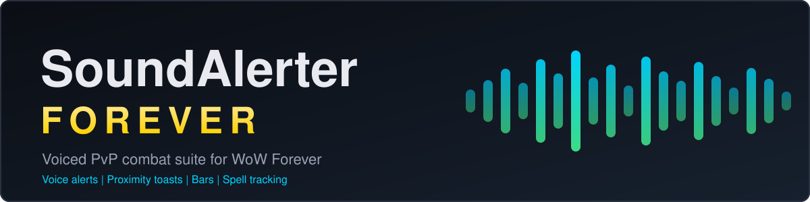
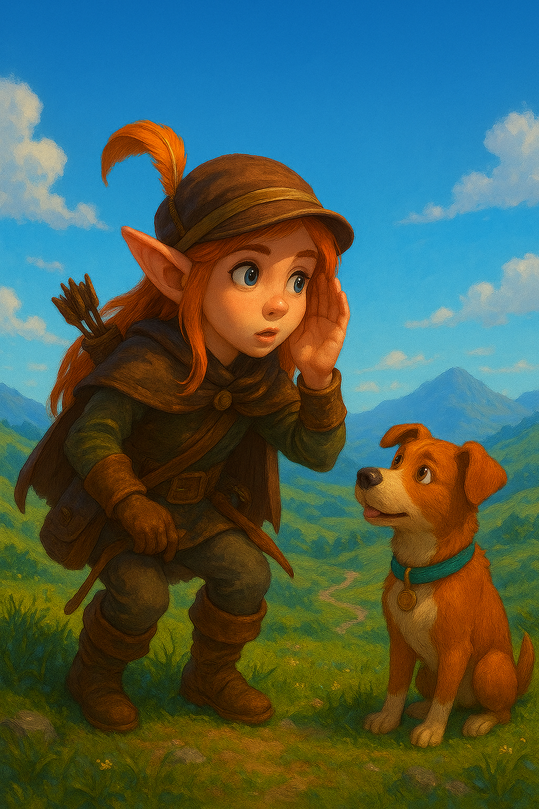
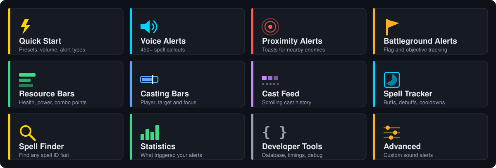
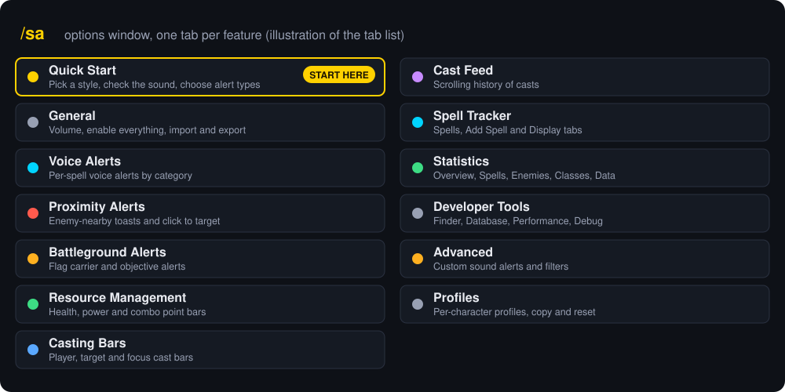
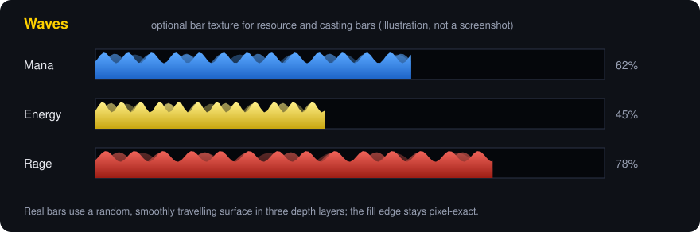
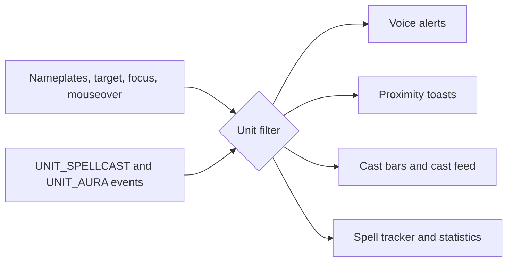

<b>Voiced PvP combat suite for WoW Forever.</b> 
Built on the legacy of SoundAlerter: voice callouts, proximity toasts, cast bars, resource bars and a spell tracker. 
<i>Still an early beta, please expect bugs.</i>

> [!IMPORTANT]
> **What changed:** WoW Forever permanently restricts `COMBAT_LOG_EVENT_UNFILTERED` for every third-party addon. That is a Blizzard platform decision, not a bug. SoundAlerter is rebuilt around nameplate and unit-event tracking instead.

| Gone | Kept |
| :--- | :--- |
| Zone-wide detection of enemies you haven't targeted or can't see a nameplate for | Voice alerts for your target, focus and every enemy with a visible nameplate |
| "Any enemy anywhere" custom sound matching | Proximity toasts, battleground flag tracking, bars, cast feed, spell tracker |
| Ally-side CC and cast monitoring | All your settings and custom alert rules carry over |

---

## What's In The Box

| Feature | What it does |
| :--- | :--- |
| **Quick Start** | Pick a style, test the sound, choose what you hear. Arena ready in a minute |
| **Voice Alerts** | 230+ spell callouts, organised by class, with presets and search |
| **Proximity Alerts** | Sticky toasts with distance, buffs and click-to-target |
| **Battleground Alerts** | Team-aware flag tracking for WSG and Eye of the Storm |
| **Resource Bars** | Health, power and combo points, with animated textures |
| **Casting Bars** | Player, target and focus bars with finish animations |
| **Cast Feed** | Scrolling cast history per unit |
| **Combat Drop Timer** | A thin line and digits counting down to the moment you leave combat |
| **Spell Tracker** | Buff, debuff and cooldown icons that keep working in combat |
| **Minimap Tracking** | Target and focus kept on the minimap across loading screens |
| **Spell Finder** | Search spell IDs and descriptions |
| **Statistics** | Which alerts fired, from whom, and where |

---

## Getting Started

1. Download the latest release and extract the `SoundAlerter` folder to `World of Warcraft/Interface/AddOns/`.
2. Launch WoW and click the minimap button, or type `/sa`.
3. Open **Quick Start**, pick a style, press **Play test sound**, and choose which alert types you want.

---

## Voice Alerts

Instant audio callouts for enemy cooldowns, crowd control and interrupts, for your target, focus and any enemy with a visible nameplate.

* **By class:** pick a class on the left, then switch events on or off per spell: Gained, Faded, Cast start, Cast, On you, On friend, On enemy, CC faded, Interrupts you
* **Presets with undo:** Arena, Battleground, Only what hits me, Big cooldowns, Silence all
* **Search** across every class by spell name or sound key
* **Interrupts:** your own interrupts, Feral Charge included, are announced with the spell you stopped; optional `/roar` emote. When the client reveals who interrupted, the announcement is exact and immediate; otherwise it still pairs by timing
* **Interrupt extras (all off by default):** a separate sound for focus interrupts (`focusinterrupted.mp3`), a minimum cast time, pet interrupts counted as yours, and an estimated "interrupt ready" call (`interruptready.mp3`). `/sa` -> General -> Interrupt Extras
* **Engine aura sounds (experimental, off by default):** hands your enabled self debuff voice alerts to the game's own aura sound system, which can play them even when the addon cannot read the aura. Those spells are then announced by the game instead of the addon and are not counted in Statistics. `/sa aurasound` tests which units the game accepts. `/sa` -> General -> Engine Aura Sounds
* **Loss of control voice (off by default):** speaks the kind of effect that hits you (stun, fear, root, silence, disarm, incapacitate, spell lockout) from the game's own loss of control data, with no spell list, and stays quiet when a self debuff alert just spoke. Add `stunned.mp3` and `incapacitated.mp3` to `Voice/` for those two. `/sa` -> General -> Loss Of Control Voice
* **Chat alerts** go to Say, Party, Raid or Instance, and fall back to your own chat when no channel is available

**Configuration**: `/sa` -> Voice Alerts

---

## Proximity And Battlegrounds

* **Proximity toasts:** nearby enemies via nameplate, target or mouseover; Close / Nearby / Medium / Detected (an optional distance limit alerts only inside the band you pick, `/sa` -> Proximity Alerts -> Distance Limit), group size, up to 3 buff icons with timers, one-click targeting, smooth stacking. When a nameplate's name or class is hidden at first, the alert retries after 0.1 s and again on name and faction updates instead of staying silent
* **Enemy awareness (off by default):** a voice alert when a nearby enemy player starts targeting you, and another when an enemy who is targeting you starts a cast. Both need the client to reveal the enemy's target and stay silent when it does not. `/sa` -> Proximity Alerts -> Enemy Awareness; add `targetingyou.mp3` and `castingonyou.mp3` to `Voice/` for sound
* **Totem nameplates (off by default):** turns on the game's enemy and friendly player totem nameplates so totems show as plates. The two game settings it changes are saved first and restored when you turn it off or log out. `/sa` -> Proximity Alerts -> Identification
* **Quiet rules:** proximity and enemy awareness alerts stay silent on flight paths and while dead (both on by default), optionally while you are not PvP flagged, and for a set time after `/sa snooze [minutes]` (`/sa unsnooze` cancels). Interrupt, crowd control and aura voice alerts are never silenced. `/sa` -> Proximity Alerts -> Quiet Rules
* **Double-voice warning:** when the game's own combat audio alerts are on, the General options page says so, because both voices may speak. SoundAlerter never changes the game's settings
* **Scoreboard class fallback:** in battlegrounds, when the client hides an enemy's class on the nameplate but the name is readable, the class comes from the scoreboard so the class voice and toast still work. `/sa` -> Proximity Alerts -> Identification
* **Flag tracking:** class identification, team-aware pickup, drop and capture toasts

**Configuration**: `/sa` -> Proximity Alerts, Battleground Alerts
**Commands**: `/sa toast test`, `/sa flag metrics`

---

## Bars And Feeds

* **Resource bars:** Health, Mana, Energy, Rage and Combo Points (10 selectable point shapes), feral form support, pixel-perfect, event-driven
* **Bar textures** shared with the casting bars: Default, Solid, Transparent, plus Waves, Streaks, Motes and Fog

* **Casting bars:** player, target and focus, channeled and mid-cast support, finish animations, configurable direction. When the game hides an enemy cast's timing, the bar is still filled by the game's own timer (without time text)
* **Combat drop timer:** a hairline bar with millisecond digits that drains toward the moment you leave combat (off by default, PvP only by default). The game does not report every hit to addons, so the countdown is an estimate that snaps to the real drop. Draggable, with saved size and position, a pulse in the last second, and a fade when you are free. `/sa ctprobe on` (debug mode) logs the combat events so the real window can be measured on your client
* **Cast feed:** one icon row per unit with hover details and time between casts (off by default). The client hides other units' casts, so some are shown generically

The options window is a flat left-hand list grouped under Setup, Alerts, Displays, Tools and Profile, with no sub-menus to open. Each module is one page of collapsible section cards (open or closed state is remembered, and the last page you used reopens), with live previews for bars, toasts, chat lines and the cast feed. Proximity, Battleground and Chat alert pages have a search box that finds any setting across those three modules; type and press Enter.

**Configuration**: `/sa` -> Resource Management, Casting Bars, Cast Feed, Combat Drop Timer

---

## Spell Tracker

* Player and target buffs, debuffs and cooldowns, working in combat
* Aura spiral, duration numbers and an optional depleting border timer
* "Ready!" when a spell is off cooldown, with state borders and glows (idle, buff, debuff, expiring, ready)
* Stays correct through druid form swaps (auras are matched by spell ID)
* **By class:** pick a class on the left, switch what each spell tracks with chips, and preview every icon state live. Presets with undo
* **Delete:** each spell has a Delete Spell button next to Size and timing, with a confirmation prompt you can turn off under Display > Delete Without Confirmation

**Configuration**: `/sa` -> Spell Tracker

---

## Tools

* **Minimap Tracking:** keeps target and focus on the minimap after every loading screen (off by default). `/sa` -> General
* **Spell Finder:** search spell names and descriptions, with fuzzy matching and autocomplete. Type a spell ID to jump straight to it, search for words in any order or from the middle of a name, and see cast time, range, icon ID, cost, charges, passive or active, and whether you know the spell. Filter results by Active or Passive and by Known or Not known.

* **Statistics:** session and all-time mix of spell, proximity, trinket, flag and interrupt alerts, with ranked spells, enemies and classes.
* **Developer Tools:** database status, performance timings and a Debug Mode that prints timestamped, module-tagged traces. `/sa` -> Developer Tools

---

## How It Works

Handlers filter on unit identity before touching any API. Aura alerts read the `UNIT_AURA` change list and only fall back to a spell-ID poll when the client hides it.

<b>Commands</b>

| Command | Action |
| :--- | :--- |
| `/sa` | Main options panel |
| `/sa help` | Full command list |
| `/sa stats` | Class detection statistics |
| `/sa probe` | What the client lets the addon read right now (name, class, guild, distance, loss of control, scoreboard, restriction state), plus the readable-or-secret counts recorded while Debug Mode is on |
| `/sa toast status` | Proximity metrics |
| `/sa flag myteam` / `metrics` | BG team check and flag metrics |

Developer commands (`/sa toast test`, `/sa flag test`) need Debug Mode on.

---

## Technical Highlights

* **Ace3** framework, per-character profiles with export
* **Zero-taint:** protected frames are never touched in combat
* **Event-driven:** nameplates plus `UNIT_SPELLCAST_*` and `UNIT_AURA` on target, focus and tracked nameplates

---

**Author**: th3pajay · **License**: MIT, open for use, modification and distribution.

Fair winds, fellow adventurers!
*th3pajay / Starmistx - An old feral (https://warcraftmovies.com/pv.php?t=3&l=pajay)*
