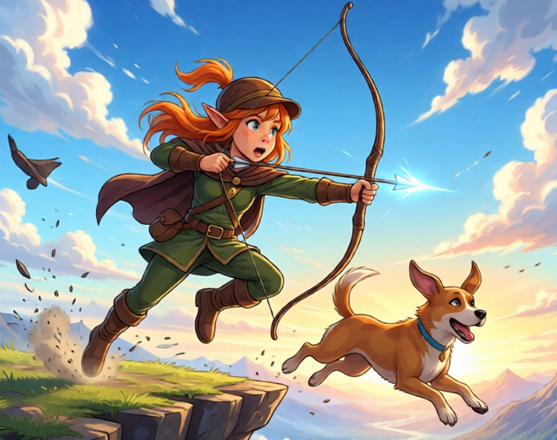
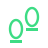

<table>
<tr>
<td width="240" valign="top"></td>
<td valign="top">

# SoundAlerter Forever

**Personal combat assistant.**
Voiced PvP alerts, bars and trackers for WoW Forever.

**Get it:** extract `SoundAlerter` to `World of Warcraft/Interface/AddOns/`, a setup wizard opens on first login (or type `/sa setup`): pick your style, check the sound, choose your helpers and warnings.

🟢 works · 🟡 partial · 🟣 experimental, off by default

</td>
</tr>
</table>

> [!IMPORTANT]
> Forever blocks the combat log for addons. Everything here runs on your **target, focus and enemies with a visible nameplate**. The client also hides some names, targets, auras and cast timing, so a few alerts can stay silent.

## Hear it

| | Feature | What it does | |
| :---: | :--- | :--- | :---: |
|  | **Spell callouts** | 230+ spells by class with per-event toggles, a play button on every sound, presets with undo and search. Covers your target and focus; turn on **All enemies in range** for other nameplates. Aura and CC alerts fall back to polling when the client hides the aura. Enemy Stealth, Prowl, Vanish and Shadowmeld are caught from the aura, so the call-out works even though the client hides the cast; **Proximity Alerts** can also repeat it as a stealthed enemy closes in | 🟢 |
|  | **Control voice** | Speaks stun, fear, root, silence, disarm and incapacitate from the game's own data | 🟣 |
|  | **Interrupts** | Calls the spell you stopped, and when you get locked out. Exact when the client names the interrupter, otherwise paired by timing. Can say when your interrupt is ready, using the cooldown it learned from your own casts | 🟢 |
|  | **Proc voices** | Says the spell when one of your own lights up. The voice comes from the spell's name, so a matching mp3 in your voice folder just works, and `/sa procs` lists which of your procs have one | 🟣 |
|  | **Chat alerts** | Say, party, raid or instance, with editable message text and a live preview, and a fallback to your own chat | 🟢 |

## See it

| | Feature | What it does | |
| :---: | :--- | :--- | :---: |
|  | **Proximity toasts** | Pop-ups for enemies nearby with both of their names, a distance band, level, group size and 3 aura icons. Pick an **Intel card** or a **Threat card**, click to target. Shows the enemy's latest spell, even when the client hides it (see **Show hidden enemy spells**). An enemy whose name or class was unreadable when their plate appeared is checked again on their next cast. Quiet rules and `/sa snooze` keep it silent when you want | 🟢 |
|  | **Awareness and watchlist** | Voice when an enemy targets you, starts a cast or uses an instant at you, and for watched players or guilds. Silent where the client hides targets or names. Optional party sharing, off by default, and a separate global sightings channel, on by default with an opt-out, whose world map panels show the counts while enemy markers on the map and minimap dots stay off unless you turn them on. The same switch shares which alert spells you saw, without names or counts and mixed with decoys, for the Global statistics tab | 🟡 |
|  | **Flag tracking** | Team-aware pickup, drop and capture toasts in WSG and Eye of the Storm. Returns too, once switched on | 🟢 |
|  | **Notices** | Cues for duels, summons, resurrections, invites, queue pops, ready checks and low durability. Each is silent until its voice file exists (`/sa notices files`) | 🟣 |

## Watch it

| | Feature | What it does | |
| :---: | :--- | :--- | :---: |
|  | **Resource bars** | Health, mana, energy, rage and combo points in 10 shapes with 8 celebration animations (each with its own spend and loss exit, or a shared Sweep out or Collapse to centre fade-out, and a Low / Normal / High quality setting; gained points ignite and lost points drain on the game's animation engine), with feral form support, a gold Poised marker on the energy bar for rogues and druids, and 10 textures, including the Liquid look with its own bevelled border and animated Fire and Leaves. Animated textures also run on vertical bars, and a Low / Normal / High texture quality adds a moving glint along the border at High. The rage bar can fade when empty. An optional swing spark runs along the border of the bar your form uses and reaches the end as your next swing lands | 🟢 |
|  | **Casting bars** | Player, target and focus bars with a segmented look, an unfurl on cast start, bloom rings on finish, a stamped INTERRUPTED, a steel look for uninterruptible casts, a red timer flip in the last 0.7 s, channel pulses and a shrink when a cast stops. The Solid, Fog and Default bar looks each have their own matching animations (edge line and wipe, storm cloud and brackets, classic spark). Low, Normal and High animation quality. Fills from the game's timer, without time text, when enemy timing is hidden | 🟡 |
|  | **Cast feed** | One icon row per unit with a cast sweep, a status glow and badge, class dots, repeat counts and the time between casts, plus an optional row for nearby enemies. Casts the client hides still show their real name, drawn by the client without the addon reading it. Turn it on with **Show hidden enemy spells** on the General page. Most enemy instants send no cast event, so only an experimental option sees those: it flashes enemy buffs and, in duels, your new debuffs beside the target and focus rows | 🟡 |
|  | **Speed meter** | Live movement speed as a percent of base run speed, green above 100% and red below | 🟢 |
|  | **Trinket menu** | Your two trinkets on a small bar with their cooldowns and keybinds (Key Bindings, SoundAlerter section). Hover a trinket for the trinkets in your bags, right-click to swap top and bottom, keep three saved sets on a set button, and switch between two equipment sets (for example damage and healing) on a gear button. These swaps wait until combat ends. An optional weapon button switches between your DPS and healing weapons at once, also in combat. A soft spark runs round a trinket once its cooldown is over. Vertical or horizontal, fade when idle, or collapse to a diamond that unfolds the bar on hover, spins back in and ripples when a trinket is ready | 🟣 |
|  | **Diminishing returns** | One icon per crowd control category in a row for the target and one for the focus: the last spell that landed with its category letters, a border showing how long the next one lasts (green half, yellow a quarter, red immune), the crowd control counting down and then the 18 second reset. Stun, opener stun, incapacitate, fear, silence, root, horror and cyclone, each switchable. Each row is draggable anywhere, any size. Counts what lands on your target or focus, from anyone | 🟣 |
|  | **Footsteps** | A dotted trail on the minimap and zone map of where you walked. Off by default, not recorded in instances or on flight paths | 🟡 |

## Tune it

| | Feature | What it does | |
| :---: | :--- | :--- | :---: |
|  | **Spell tracker** | Buff, debuff and cooldown icons that work in combat, with spiral and border timers, a pop-in, a border that shifts from green to red as time runs out, a red tint warning, a shrink when the aura ends and a shine when a cooldown is ready. Low, Normal and High animation quality. One click adds Death Mark on you as a debuff countdown, every rank included. Spells tracked on your target can sit in a row above its nameplate instead (off by default), stacked over the game's own aura icons, the one ending soonest drawn larger. The timer starts on cast, because a landed hit cannot be confirmed in combat. A buff you cast stops its timer when it is consumed early, where the game shows that | 🟢 |
|  | **Minimap tracking** | Keeps target and focus on the minimap across loading screens | 🟢 |
|  | **Spell Finder** | Search spell IDs, names and descriptions with fuzzy match, filters, keyboard control and full spell details in a draggable window, plus a Developer Tools page with a health verdict for the spell database | 🟢 |
|  | **Statistics** | Session and all-time counts of which alerts fired, from whom, and where, with a Snapshot panel (Now, Trends, Rivals, Visuals, a Venn diagram of your spells by Arena, Battleground and World PvP, and Global, ranked bars of how many SoundAlerter players on your realm and faction saw each spell in arenas, battlegrounds and world PvP over the last 7 days, sortable by zone, with a compact export for websites) that also shows party sharing, and a debrief of your last 20 arena and battleground matches (won or lost with your record, length, alerts, enemies, top spells, time in CC, your damage and healing) | 🟢 |
|  | **Quick Start** | A six-step setup wizard: style, what to hear with volume and a test sound, on-screen helpers, awareness, party sharing and a summary. Opens by itself once on a new install and any time from the Quick Start page or `/sa setup` | 🟢 |
| 🔔 | **Update notice** | One chat line when a newer version is out. Addons cannot reach the internet, so it learns this from other players' copies, and each announcement carries a proof that only a real release can have. It waits until two different players have proven the same release, so a single test copy cannot start it. It never contains a link: update through CurseForge. Can be turned off under General | 🟡 |
| 🎞️ | **Options window motion** | Pages slide in, rows tint on hover, switches glide, a changed setting flashes its row, buttons dip when pressed and a failed import shakes. One setting in General turns all of it off | 🟡 |
| 🗺️ | **Minimap button** | Every Shift, Ctrl and Alt click on the left, right and middle button can run an action: options, a quick switch menu, proximity, battleground, snooze, lock bars, chat alerts, notices, next profile, Spell Finder, statistics or a test voice. The icon and tooltip follow your settings, with 12 icons to choose per state | 🟡 |

## Commands

| Command | Action |
| :--- | :--- |
| `/sa` | Options window |
| `/sa setup` | Run the Quick Start setup wizard |
| `/sa help` | Full command list |
| `/sa probe` | What the client lets the addon read right now |
| `/sa meter` | What the game's damage meter reports for you, used by the match debrief |
| `/sa perf` | Frame time and memory SoundAlerter uses |
| `/sa procs` | Procs seen since login and which have a voice |
| `/sa updates` | What the update notice knows |
| `/sa secrets` | Whether the hidden-spell display routes work on this client |
| `/sa stats [reset]` | Alert diagnostics: same spell alerted twice, aura resyncs, proximity checks skipped just after loading a zone |
| `/sa speed` | The raw speed values and what the Speed Meter would show, for checking swimming |
| `/sa fxstats [reset]` | How often the casting bars and spell tracker icons update at your animation quality |
| `/sa global` | Global sightings and global statistics status |
| `/sa snooze [min]` / `unsnooze` | Silence proximity alerts |
| `/sa watch [guild] <name>` | Manage the watchlist |

Built on Ace3 with per-character profiles you can list, switch, copy, create, delete and reset from one page, plus Spell Tracker blocks that share or merge just your tracked spells, display settings or icon layout, and a custom alert editor with your own sounds for any spell event. Protected frames are never touched in combat.

## Credits

Drawing a spell the client hides, by letting the client draw it on screen, was inspired by [Forever Simple GCD](https://www.curseforge.com/members/tarolg/projects) by tarolg (MIT). Thank you.

MIT · th3pajay / Starmistx
