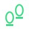

<table>
<tr>
<td width="240" valign="top"></td>
<td valign="top">

# SoundAlerter Forever

**Personal combat assistant.**
Voiced PvP alerts, bars and trackers for WoW Forever.

**Get it:** extract `SoundAlerter` to `World of Warcraft/Interface/AddOns/`, a setup wizard opens on first login (or type `/sa setup`): pick your style, check the sound, choose your helpers and warnings.

🟢 works · 🟡 partial · 🟣 experimental, off by default

</td>
</tr>
</table>

> [!IMPORTANT]
> Forever blocks the combat log for addons. Everything here runs on your **target, focus and enemies with a visible nameplate**. The client also hides some names, targets, auras and cast timing, so a few alerts can stay silent.

## Hear it

| | Feature | What it does | |
| :---: | :--- | :--- | :---: |
|  | **Spell callouts** | 230+ spells by class with per-event toggles, a play button on every sound, presets with undo and search. Covers your target and focus; turn on **All enemies in range** for other nameplates. Aura and CC alerts fall back to polling when the client hides the aura. Enemy Stealth, Prowl, Vanish and Shadowmeld are caught from the aura, so the call-out works even though the client hides the cast; **Proximity Alerts** can also repeat it as a stealthed enemy closes in | 🟢 |
|  | **Control voice** | Speaks stun, fear, root, silence, disarm and incapacitate from the game's own data | 🟣 |
|  | **Interrupts** | Calls the spell you stopped, and when you get locked out. Exact when the client names the interrupter, otherwise paired by timing | 🟢 |
|  | **Chat alerts** | Say, party, raid or instance, with editable message text and a live preview, and a fallback to your own chat | 🟢 |

## See it

| | Feature | What it does | |
| :---: | :--- | :--- | :---: |
|  | **Proximity toasts** | Pop-ups for enemies nearby with a distance band, level, group size and 3 aura icons. Pick an **Intel card** or a **Threat card**, click to target. Shows the enemy's latest spell, even when the client hides it (see **Show hidden enemy spells**). An enemy whose name or class was unreadable when their plate appeared is checked again on their next cast. Quiet rules and `/sa snooze` keep it silent when you want | 🟢 |
|  | **Awareness and watchlist** | Voice when an enemy targets you, starts a cast or uses an instant at you, and for watched players or guilds. Silent where the client hides targets or names. Optional party sharing and an experimental global sightings map, both off by default | 🟡 |
|  | **Flag tracking** | Team-aware pickup, drop and capture toasts in WSG and Eye of the Storm. Returns too, once switched on | 🟢 |
|  | **Notices** | Cues for duels, summons, resurrections, invites, queue pops, ready checks and low durability. Each is silent until its voice file exists (`/sa notices files`) | 🟣 |

## Watch it

| | Feature | What it does | |
| :---: | :--- | :--- | :---: |
|  | **Resource bars** | Health, mana, energy, rage and combo points in 10 shapes with 8 celebration animations (each with its own spend and loss exit, and a Low / Normal / High quality setting), with feral form support and 8 textures, including the Liquid look with its own bevelled border. Animated textures also run on vertical bars, and a Low / Normal / High texture quality adds a moving glint along the border at High | 🟢 |
|  | **Casting bars** | Player, target and focus bars with a segmented look, an unfurl on cast start, bloom rings on finish, a stamped INTERRUPTED, a steel look for uninterruptible casts, a red timer flip in the last 0.7 s, channel pulses and a shrink when a cast stops. The Solid, Fog and Default bar looks each have their own matching animations (edge line and wipe, storm cloud and brackets, classic spark). Low, Normal and High animation quality. Fills from the game's timer, without time text, when enemy timing is hidden | 🟡 |
|  | **Cast feed** | One icon row per unit with a cast sweep, a status glow and badge, class dots, repeat counts and the time between casts, plus an optional row for nearby enemies. Casts the client hides still show their real name, drawn by the client without the addon reading it. Turn it on with **Show hidden enemy spells** on the General page. Most enemy instants send no cast event, so only an experimental option sees those: it flashes enemy buffs and, in duels, your new debuffs beside the target and focus rows | 🟡 |
|  | **Combat timer** | Millisecond countdown to leaving combat. An estimate that snaps to the real drop | 🟡 |
|  | **Speed meter** | Live movement speed as a percent of base run speed, green above 100% and red below | 🟢 |
|  | **Trinket menu** | Your two trinkets on a small bar with their cooldowns and keybinds. Hover a trinket for the trinkets in your bags, right-click to swap top and bottom, keep three saved sets on a set button, and switch between two equipment sets (for example damage and healing) on a gear button. Swaps in combat wait until combat ends. Vertical or horizontal, fade when idle, or collapse to a diamond | 🟣 |
|  | **Footsteps** | A dotted trail on the minimap and zone map of where you walked. Off by default, not recorded in instances or on flight paths | 🟡 |

## Tune it

| | Feature | What it does | |
| :---: | :--- | :--- | :---: |
|  | **Spell tracker** | Buff, debuff and cooldown icons that work in combat, with spiral and border timers, a pop-in, a border that shifts from green to red as time runs out, a red tint warning, a shrink when the aura ends and a shine when a cooldown is ready. Low, Normal and High animation quality. The timer starts on cast, because a landed hit cannot be confirmed in combat | 🟢 |
|  | **Minimap tracking** | Keeps target and focus on the minimap across loading screens | 🟢 |
|  | **Spell Finder** | Search spell IDs, names and descriptions with fuzzy match, filters, keyboard control and full spell details in a draggable window, plus a Developer Tools page with a health verdict for the spell database | 🟢 |
|  | **Statistics** | Session and all-time counts of which alerts fired, from whom, and where, with a Snapshot panel (Now, Trends, Rivals) that also shows party sharing | 🟢 |
|  | **Quick Start** | A six-step setup wizard: style, what to hear with volume and a test sound, on-screen helpers, awareness, party sharing and a summary. Opens by itself once on a new install and any time from the Quick Start page or `/sa setup` | 🟢 |
| 🎞️ | **Options window motion** | Pages slide in, rows tint on hover, switches glide, a changed setting flashes its row, buttons dip when pressed and a failed import shakes. One setting in General turns all of it off | 🟡 |
| 🗺️ | **Minimap button** | Every Shift, Ctrl and Alt click on the left, right and middle button can run an action: options, a quick switch menu, proximity, battleground, snooze, lock bars, chat alerts, notices, next profile, Spell Finder, statistics or a test voice. The icon and tooltip follow your settings, with 12 icons to choose per state | 🟡 |

## Commands

| Command | Action |
| :--- | :--- |
| `/sa` | Options window |
| `/sa setup` | Run the Quick Start setup wizard |
| `/sa help` | Full command list |
| `/sa probe` | What the client lets the addon read right now |
| `/sa secrets` | Whether the hidden-spell display routes work on this client |
| `/sa stats [reset]` | Alert diagnostics: same spell alerted twice, aura resyncs, proximity checks skipped just after loading a zone |
| `/sa speed` | The raw speed values and what the Speed Meter would show, for checking swimming |
| `/sa fxstats [reset]` | How often the casting bars and spell tracker icons update at your animation quality |
| `/sa global` | Global sightings status |
| `/sa snooze [min]` / `unsnooze` | Silence proximity alerts |
| `/sa watch [guild] <name>` | Manage the watchlist |

Built on Ace3 with per-character profiles you can list, switch, copy, create, delete and reset from one page, and a custom alert editor with your own sounds for any spell event. Protected frames are never touched in combat.

## Credits

Drawing a spell the client hides, by letting the client draw it on screen, was inspired by [Forever Simple GCD](https://www.curseforge.com/members/tarolg/projects) by tarolg (MIT). Thank you.

MIT · th3pajay / Starmistx
